<!-- tailor:social-header:start -->
<p align="center">
  <a href="https://ia-get.wimpys.world"><picture><source media="(prefers-color-scheme: dark)" srcset="pages/social/hero-dark.svg"></picture></a>
</p>
<!-- tailor:social-header:end -->

<!-- tailor:social-links:start -->
<p align="center">
  <a href="https://bsky.app/profile/wimpys.world"><picture><source media="(prefers-color-scheme: dark)" srcset="pages/social/link-bluesky-dark.svg"></picture></a>
  <a href="https://wimpysworld.social/@martin"><picture><source media="(prefers-color-scheme: dark)" srcset="pages/social/link-mastodon-dark.svg"></picture></a>
  <a href="https://linkedin.com/in/martinwimpress"><picture><source media="(prefers-color-scheme: dark)" srcset="pages/social/link-linkedin-dark.svg"></picture></a>
</p>
<!-- tailor:social-links:end -->

<!-- tailor:social-community:start -->
<p align="center">
  <a href="https://discord.com/invite/vUsydfP"><picture><source media="(prefers-color-scheme: dark)" srcset="https://raw.githubusercontent.com/wimpysworld/ia-get/social-assets/community-dark.svg"></picture></a>
</p>
<!-- tailor:social-community:end -->

`ia-get` is a command-line downloader for [archive.org](https://archive.org/). Give it an item `/details/` URL to download every file with its original folders, or a `/download/` URL for a single file, with preview, glob filtering, polite parallel transfers, resume, and automatic MD5 verification.

## Features

- **One URL, whole archive:** `ia-get` downloads every file with its original folders from an archive.org `/details/` link, or one file from a `/download/` link.
- **Fast and polite automatically:** `ia-get` downloads small and medium files in parallel with zero flags and slows down for large files. It backs off on rate limits to respect the Internet Archive's wishes and [automated access guidelines](https://archive.org/developers/bots.html).
- **Live terminal UI:** The inline display shows active parallel downloads, a throughput sparkline, regional mirror flags, and overall progress. Calm warnings appear at the end, and your terminal scrollback stays intact.
- **Preview and cherry-pick:** Run `--list` to inspect every file and size before you download. Use `-f` glob patterns to include or exclude files.
- **Resume and verify:** Interrupted downloads pick up where they left off, and finished files pass automatic MD5 checks. Run `--check` to verify a local folder without changing a file.
- **Private items, speed caps, and proxies:** Pass browser cookies with `-b` for login-only items, or cap total speed with `--limit-rate`. `ia-get` follows system proxies automatically and skips private files when you do not pass cookies.
- **Native and safe everywhere:** `ia-get` is a fast standalone binary for Linux, macOS, and Windows. It checks free disk space first and keeps every write inside your target folder.

<!-- tailor:social-stats:start -->
<p align="center">
  <a href="https://github.com/wimpysworld/ia-get/pulse"><picture><source media="(prefers-color-scheme: dark)" srcset="https://raw.githubusercontent.com/wimpysworld/ia-get/social-assets/stats-dark.svg"></picture></a>
</p>
<!-- tailor:social-stats:end -->

## Install

First-party signed package repositories are published for Linux, macOS, and Windows through [wimpys.world](https://wimpys.world/). Choose your platform below for setup instructions and automatic updates.

<!-- tailor:social-packages:start -->
<p align="center">
  <a href="https://apt.wimpys.world/#ia-get"><picture><source media="(prefers-color-scheme: dark)" srcset="pages/social/pkg-apt-dark.svg"></picture></a>
  <a href="https://rpm.wimpys.world/#ia-get"><picture><source media="(prefers-color-scheme: dark)" srcset="pages/social/pkg-rpm-dark.svg"></picture></a>
  <a href="https://pkg.wimpys.world/#ia-get"><picture><source media="(prefers-color-scheme: dark)" srcset="pages/social/pkg-pkg-dark.svg"></picture></a>
  <a href="https://apk.wimpys.world/#ia-get"><picture><source media="(prefers-color-scheme: dark)" srcset="pages/social/pkg-apk-dark.svg"></picture></a>
  <br>
  <a href="https://brew.wimpys.world/#ia-get"><picture><source media="(prefers-color-scheme: dark)" srcset="pages/social/pkg-brew-dark.svg"></picture></a>
  <a href="https://scoop.wimpys.world/#ia-get"><picture><source media="(prefers-color-scheme: dark)" srcset="pages/social/pkg-scoop-dark.svg"></picture></a>
  <a href="https://nix.wimpys.world/#ia-get"><picture><source media="(prefers-color-scheme: dark)" srcset="pages/social/pkg-nix-dark.svg"></picture></a>
</p>
<!-- tailor:social-packages:end -->

<details>
<summary><strong>Any platform (<code>bin</code>)</strong> - install and update the release binary directly</summary>

[bin](https://github.com/marcosnils/bin) installs and updates the release binary:

```shell
bin install github.com/wimpysworld/ia-get
```

</details>

<!-- tailor:social-sponsors:start -->
<p align="center">
  <a href="https://github.com/sponsors/flexiondotorg"><picture><source media="(prefers-color-scheme: dark)" srcset="pages/social/sponsors-dark.svg"></picture></a>
</p>
<!-- tailor:social-sponsors:end -->

## Quick start

```shell
# Download an entire archive item with its original folders
ia-get https://archive.org/details/<identifier>

# Download a single file directly
ia-get https://archive.org/download/<identifier>/<path>

# Preview files and sizes without downloading anything
ia-get --list https://archive.org/details/<identifier>

# Save files into a chosen folder
ia-get -o ./downloads https://archive.org/details/<identifier>

# Download only PDFs and exclude *_text.pdf files
ia-get -f '*.pdf' -f '!*_text.pdf' https://archive.org/details/<identifier>

# Verify an existing local folder without downloading or changing files
ia-get --check -o ./downloads https://archive.org/details/<identifier>
```

<!-- tailor:social-demo:start -->
<p align="center">
  
</p>
<!-- tailor:social-demo:end -->

Read the full guides on the wiki:

- [Usage](https://github.com/wimpysworld/ia-get/wiki/Usage) for all options, glob filtering, bandwidth limits, and verbose logging.
- [Authentication and Networking](https://github.com/wimpysworld/ia-get/wiki/Authentication-and-Networking) for cookies, redirect handling, proxies, retries, and polite parallel downloads.
- [Reliability and Safety](https://github.com/wimpysworld/ia-get/wiki/Reliability-and-Safety) for `.part` resume staging, disk-space checks, filename sanitisation, and collision validation.

## Why? 🤔💭

I wanted to download high-quality scans of [ZZap!64 magazine](https://en.wikipedia.org/wiki/Zzap!64) and some read-only memory from archive.org.
Archives of this type often include many large files, torrents are not always provided and when they are available they do not index all the available files in the archive.

Archive.org publishes XML documents for every page that indexes every file available.
So I co-authored `ia-get` to automate the download process.

### Sharing is caring 🤝

You can use `ia-get` to download files from archive.org, including all the metadata and the `.torrent` file, if there is one.
You can then start seeding the torrent using a pristine copy of the archive, and a complete file set.
For multi-terabyte archives of multi-gigabyte files, use the item's `.torrent` file (BitTorrent with webseeds) instead of overloading archive.org HTTP datanodes.

## A.I. Driven Development 🤖

This program is an experiment 🧪 In late 2023, it was initially co-authored using [Chatty Jeeps](https://ubuntu.social/@popey/111527182881051626).
When I started this project, I had no experience 👶 with [Rust](https://www.rust-lang.org/) and was curious to see if I could use AI tools to assist in developing a program in a language I do not know.

**As featured on [Linux Matters](https://linuxmatters.sh) podcast!** 🎙️ I am a presenter on Linux Matters and we discussed how the [initial version of the program](https://github.com/wimpysworld/ia-get/tree/5f2b356e7d841f2756780e2a101cf8be4041a7f6) was created using Chatty Jeeps (ChatGPT-4) in [Episode 16 - Blogging to the Fediverse](https://linuxmatters.sh/16/).

I discussed that process, its successes, and drawbacks. In a future episode, we will discuss the latest version of the project.

<div align="center">
  <a href="https://linuxmatters.sh" target="_blank"></a>
  <br />
  <em>Linux Matters Podcast</em>
</div>

Since that initial MVP, I used [Unfold.ai](https://unfoldai.io/) to add features and improve the code 🧑‍💻.
All commits from October 27, 2023, until the end of December 2023 that were AI co-authored have full details of the AI contribution in the commit messages.
Linux Matters listener [Daniel Dewberry](https://github.com/DanielDewberry) submitted a [*"peer review"* of ia-get](https://github.com/wimpysworld/ia-get/issues/7) in January 2024.
The project had little development activity until May 2025, when I incorporated the improvements Daniel had suggested.

I picked up some Rust along the way. In May 2025, I broke the crate into dedicated modules with structured error handling, streaming MD5 checks, and graceful interrupts, combining my own edits with GitHub Copilot, Gemini 2.5 Pro, and the Claude 3.7 and 4 model families. In 2026, I added `--list`, `--check`, glob filters, scoped cookies, polite parallel downloads, and multi-platform packaging, then used Gemini 4 Neon to harden transfers and rebuild the terminal interface with Ratatui.

## Documentation and development

See the [Wiki](https://github.com/wimpysworld/ia-get/wiki) for detailed guides and command reference.
See the [Development](https://github.com/wimpysworld/ia-get/wiki/Development) page for building, testing, and contributing.

<!-- tailor:social-stars:start -->
<p align="center">
  <a href="https://github.com/wimpysworld/ia-get/stargazers"><picture><source media="(prefers-color-scheme: dark)" srcset="https://raw.githubusercontent.com/wimpysworld/ia-get/social-assets/stars-dark.svg"></picture></a>
</p>
<!-- tailor:social-stars:end -->

<!-- tailor:social-contributors:start -->
<p align="center">
  <a href="https://github.com/wimpysworld/ia-get/graphs/contributors"><picture><source media="(prefers-color-scheme: dark)" srcset="https://raw.githubusercontent.com/wimpysworld/ia-get/social-assets/contributors-dark.svg"></picture></a>
</p>
<!-- tailor:social-contributors:end -->

<!-- tailor:social-footer:start -->
<p align="center">
  <a href="https://tailor.wimpys.world"><picture><source media="(prefers-color-scheme: dark)" srcset="pages/social/footer-dark.svg"></picture></a>
</p>
<!-- tailor:social-footer:end -->
